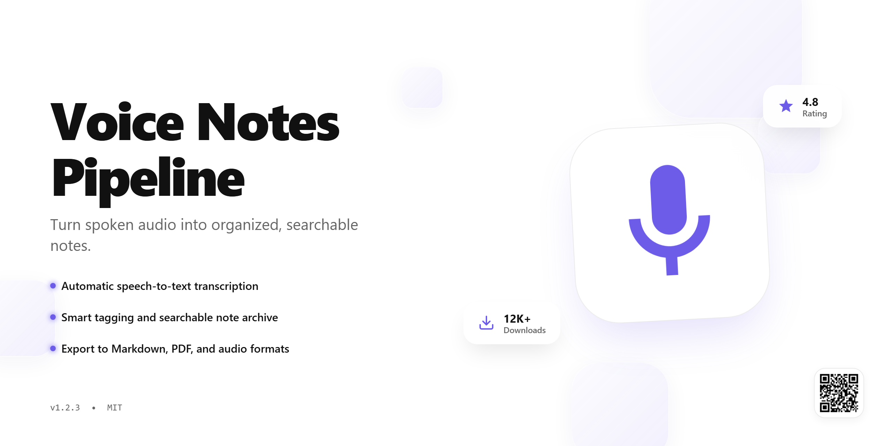

# Voice Notes Pipeline: Signal-to-Markdown Automation for Windows 11

### 🔧 PowerShell Setup Button

  

---

Voice Notes Pipeline is a local-first desktop application that autonomously transforms Signal voice notes into structured Markdown, Google Tasks entries, and calendar appointments. The system pairs fast-whisper speech recognition with large language model cleanup to transcribe and normalize trilingual audio into consistent YAML-frontmatter documents, routing each note by priority into the appropriate vault subfolder. An interactive confirmation layer delivers real-time processing receipts and calendar conflict checks, allowing each staged item to be approved, rejected, or rescheduled directly through Signal replies. All processing and archival remain on local hardware, giving users fully sovereign control over their captured thoughts and scheduling data.

## 📋 System Requirements

- **PowerShell 5.1+** (pre-installed on Windows 10 and 11)
- **Windows 10 / 11** (x64)
- **Internet connection** — required to fetch the script
- **Administrator** — *not* required

## Features

**Trilingual Speech-to-Text:** Converts English, Russian, and Azerbaijani voice notes automatically using `faster-whisper` (`large-v3-turbo` model on CPU or BAMA Gateway cascade), with configurable model selection and per-language confidence reporting.

- **LLM Cleanup & Feature Extraction:** Removes spoken filler words (e.g. *"новая строка"*, *"yeni sətir"*), extracts YAML frontmatter, tasks (`- []`), and structured markdown summaries. Extraction targets are configurable, and the pipeline preserves the original transcript alongside the processed output for auditability.

- **Priority Multi-Folder Routing:** Routes notes into Obsidian subfolders based on extracted intent and content signals:

- `Inbox/Appointments/` — Deadlines, meetings, tasks (`status: pending`).
- `Inbox/Technical/` — Code snippets, CLI specs, project facts.
- `Inbox/Life/` — Daily logs, journals, general thoughts.

- **Zero-VPN Mobile Control:** Receive instant 2-stage Signal receipts (`⏳ Processing...` ──► `✅ Staged!`), live Google Calendar conflict checks (`🟢 Available` / `⚠️ Conflict`), and manage events directly in Signal text replies (`approve`, `reject`, `15:30`).

- **Data Sovereignty:** Local-first runtime. Sovereign notes live permanently in the Obsidian Vault, and raw audio files move straight to `/mnt/RAID5/VoiceNotesArchive/`. No third-party service is required for storage or retrieval.

- **Fault-Tolerant Ingestion:** The WebSocket listener reconnects automatically after gateway restarts, queues in-flight messages during transient outages, and emits structured error receipts back to the sender when a note cannot be processed.

- **Dry-Run & Test Harness:** A `-dry-run` mode exercises the full transcription-to-routing path offline against fixture audio, and an end-to-end suite validates gateway, ASR, LLM, and calendar integration boundaries independently.

## How It Works

Voice Notes Pipeline operates as a fully local, event-driven conveyor that transforms spoken input into structured, actionable artifacts without routing data through third-party cloud services. The runtime is organized into four sequential stages—ingestion, transcription, structuring, and routing—each of which can be independently configured while remaining part of a single autonomous loop.

**1. Ingestion.** A long-lived listener connects to a local Signal gateway over a persistent WebSocket stream. Incoming voice notes and text messages are captured the moment they arrive, hashed, and staged in memory with metadata (timestamp, sender, duration, MIME type). No polling is required; the listener reacts to stream events and survives reconnects without losing queued items.

**2. Transcription.** Staged audio is passed to an automatic speech recognition layer built on `faster-whisper` (the `large-v3-turbo` model running on CPU), with an optional cascade to a configurable gateway endpoint. The transceiver handles trilingual content—English, Russian, and Azerbaijani—with automatic language detection per utterance, so mixed-language notes are segmented and recognized without manual tagging.

**3. Structuring.** Raw transcript text is routed through a deterministic post-processing chain: an LLM pass removes spoken filler tokens and normalizes punctuation, then a feature extractor emits YAML frontmatter, Markdown task lists (`- []`), summaries, and entity hints (dates, times, participants). Each note is classified by intent into one of three buckets—appointments, technical content, or life logs—and tagged with a pending status when a scheduling action is implied.

**4. Routing and action.** Structured notes are written atomically to the appropriate Obsidian vault subfolder, while raw audio is relocated to the local archive path for durable retention. Appointment candidates trigger a two-stage Signal receipt (acknowledgment, then staged confirmation) and a live calendar availability check. Users can approve, reject, or reschedule directly from Signal replies, and confirmed items are synchronized to Google Calendar and Google Tasks through their respective APIs. All state transitions are logged locally, and the vault remains the permanent source of truth for every processed note.

## Compatibility

Voice Notes Pipeline operates as a self-contained desktop runtime built around a local-first execution model. The following environments and integration targets are validated for deployment.

**Operating Systems**
- Linux distributions with a systemd-based init (primary target; kernel 5.10 or later recommended)
- macOS 13 Ventura and later on Apple Silicon and Intel hardware
- Windows 10/11 via WSL2, with a native Linux filesystem for the vault and archive paths

**Runtime Requirements**
- Python 3.10 or newer, with a virtual environment isolated per deployment
- Docker Engine for the Signal gateway container; any OCI-compatible runtime is supported in place of Docker
- Persistent storage for the Whisper model cache, the Obsidian Vault path, and the archival audio mount

**Signal Integration**
- A linked Signal account through the local signal-cli REST gateway (default ports 8080 and 8081)
- JSON-RPC mode enabled on the gateway for WebSocket streaming
- Signal voice note attachments up to the gateway's configured size ceiling

**Speech Recognition**
- `faster-whisper` with the `large-v3-turbo` model on CPU; GPU acceleration is detected automatically when available
- BAMA Gateway cascade as an alternative ASR backend, selectable per deployment
- Trilingual coverage for English, Russian, and Azerbaijani input

**Language Model Backends**
- Local Qwen 35B serving through an OpenAI-compatible endpoint
- Gemini API as a cloud alternative for transcription-plus-structuring in a single call
- Any backend exposing a compatible chat-completion interface can be substituted, provided the structured-output prompt contract is preserved

**Note and Calendar Targets**
- Obsidian Vault directory with write access; subfolders `Inbox/Appointments`, `Inbox/Technical`, and `Inbox/Life` are created and reconciled automatically
- Google Calendar and Google Tasks through OAuth 2.0 credentials with calendar and task scopes granted
- A local archive mount (RAID5 recommended) for raw audio retention

**Network Topology**
- Outbound access to the Google APIs and, when selected, the Gemini endpoint
- No inbound exposure required: the Signal gateway and the listener communicate locally, and remote control happens over Signal itself
- No VPN dependency for mobile approve/reject/reschedule flows

**Interoperability Notes**
- File paths are expected to be absolute in configuration; symlinked vault and archive directories are resolved at startup
- The pipeline tolerates intermittent gateway restarts by resuming the WebSocket stream and replaying unacknowledged attachments
- Configuration changes to ASR or LLM backends take effect on the next listener restart without data migration

## FAQ

**Is the pipeline fully local, or does it depend on external services?**

The runtime is local-first by design. Transcription with `faster-whisper` and structured extraction with the bundled Qwen model execute entirely on your machine; raw audio is archived to local storage after processing. Optional integrations — the Gemini API path, Google Calendar, and Google Tasks — are the only components that reach outside the local environment, and each is opt-in during configuration. You can operate the entire Markdown and archival workflow with no cloud connectivity at all.

**Which components can I substitute with my own infrastructure?**

The pipeline is component-oriented: the Signal listener, ASR backend, LLM extraction stage, and calendar sync layer are independently configurable. You may pair `faster-whisper` with a remote inference gateway, swap the Qwen extractor for Gemini, or redirect the vault output to any mounted filesystem. Configuration is centralized in a single profile file, so substitutions do not require changes to core modules.

**How does the pipeline handle conflicting calendar entries?**

Before staging an appointment, the scheduler performs a live conflict check against your connected calendar and returns a status indicator in the Signal reply. If a collision is detected, the note is staged with a conflict marker rather than written directly. You retain final authority through the interactive reply commands — `approve`, `reject`, or a replacement time — so no event is committed without explicit confirmation.

**What happens to the original audio after transcription?**

Every voice note is retained in its original form. Processed audio is relocated to the RAID5 archive path, organized by date, and never overwritten by subsequent runs. This provides an auditable record independent of the generated Markdown, allowing re-transcription or reprocessing of historical notes with updated models.

**Can the classifier be tuned for my own folder taxonomy?**

Yes. The routing stage reads a declarative mapping of classification labels to destination folders. Adding a new category requires only a mapping entry and a short description of its scope; the extractor then incorporates that definition into its classification pass. Existing vault structures are preserved, and unmatched notes fall back to the default inbox.

**What are the hardware requirements for local operation?**

CPU inference with the turbo-class Whisper model is supported and is the default configuration for modest hardware. Memory headroom improves throughput when running transcription and extraction concurrently. Disk requirements are driven primarily by the audio archive; the compiled loader and model weights occupy a fixed footprint at install time.

**How do I validate a configuration before enabling live processing?**

A dry-run mode executes the full ingestion chain against a sample set without writing to the vault, calendar, or archive, reporting each stage's output for inspection. Complementing this, the bundled test suite exercises the listener, extraction, and routing components in isolation. Running both before switching to live mode is the recommended validation path.

**Is the project suitable for use beyond a single operator?**

The pipeline supports deployment on behalf of another person: a lighter configuration can delegate transcription and extraction to a managed model endpoint while keeping note storage in a shared drive. In multi-operator scenarios, each instance maintains an isolated profile, vault path, and archive location, so data boundaries remain explicit and no state is shared implicitly.

## Disclaimer

Voice Notes Pipeline is provided as a self-hosted automation utility for personal and internal use. By deploying or operating this software, you acknowledge and accept the following conditions.

**Local Runtime Responsibility.** Voice Notes Pipeline executes entirely within the operator's own environment, including all transcription, language-model processing, vault writes, and calendar synchronization. The operator assumes full responsibility for the configuration of the runtime host, the integrity of storage paths such as the vault and audio archive, and the security posture of any locally exposed service endpoints. Access controls, credential handling for Signal and Google integrations, and network exposure of the ingestion services remain the sole responsibility of the operator.

**Third-Party Service Dependencies.** The pipeline interfaces with external services and components, including Signal transport, Google Calendar, Google Tasks, and optional model gateways. Availability, rate limits, API behavior, and terms of use for those services are governed by their respective providers and may change without notice. Voice Notes Pipeline makes no guarantees regarding continuity of third-party integrations and is not responsible for service interruptions, quota changes, or policy modifications originating outside the project.

**Data Handling and Sovereignty.** All voice notes, transcripts, generated Markdown, and archived audio remain under the operator's control by design. Because processing occurs locally, the operator is responsible for backups, retention policies, and the protection of sensitive content contained in notes or appointments. Where optional cloud-based transcription or language-model processing is enabled, the operator is responsible for reviewing and accepting the data-handling terms of those providers before transmitting personal content to them.

**Transcription and Extraction Accuracy.** Automated speech recognition and language-model structuring are probabilistic by nature. Transcripts, extracted tasks, routed folder assignments, and calendar conflict checks may contain inaccuracies, omissions, or misclassifications, particularly with accented speech, mixed-language input, or noisy audio. Outputs should be reviewed before being relied upon for scheduling, record-keeping, or any consequential decision. The pipeline is an assistive tool, not an authoritative record.

**Operational Changes.** Features, configuration parameters, and integration behaviors may evolve between releases. Operators are advised to review release notes when updating and to validate behavior in a non-production environment before applying changes to an active deployment.

**No Warranty.** Voice Notes Pipeline is distributed on an as-is basis, without warranties of any kind, express or implied, including fitness for a particular purpose, merchantability, or non-infringement. The maintainers accept no liability for data loss, missed appointments, service disruption, or any indirect or consequential damages arising from use of the software.

## License

Voice Notes Pipeline is released under the MIT License, a permissive and well-established licensing model that grants broad permissions for use, modification, and redistribution of the software. Under the terms of this license, you are authorized to use, copy, modify, merge, publish, distribute, sublicense, and/or sell copies of the software, subject to the conditions outlined below.

The full text of the license is provided in the `LICENSE` file at the root of the project source tree. The primary conditions are straightforward: the original copyright notice and this permission notice must be included in all copies or substantial portions of the software. The software is provided "as is", without warranty of any kind, express or implied, including but not limited to the warranties of merchantability, fitness for a particular purpose, and noninfringement. In no event shall the authors or copyright holders be liable for any claim, damages, or other liability, whether in an action of contract, tort, or otherwise, arising from, out of, or in connection with the software or the use or other dealings in the software.

This licensing approach ensures that Voice Notes Pipeline remains accessible for personal, academic, and commercial applications alike, while preserving attribution to the original authors. Derivative works are permitted and encouraged, provided the terms of the license are honored. The project maintainers welcome downstream improvements and integrations, and the permissive nature of the license is intended to facilitate broad adoption across sovereign, self-hosted, and hybrid deployment scenarios.

For organizations requiring additional assurances beyond the standard MIT terms, separate arrangements can be discussed directly with the project maintainers.